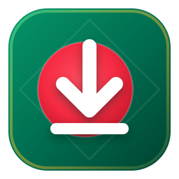
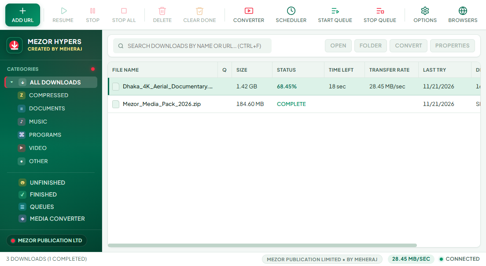

# MEZOR HYPERS
### High-Speed Bangladeshi Download Manager, Video Converter & Multi-Browser Suite

**Created by MEHERAJ • Published by MEZOR PUBLICATION LIMITED**

[-MEZOR--HYPERS--Setup.exe-006A4E?style=for-the-badge&logo=windows&logoColor=white)](https://github.com/meheraj9920-lang/MEZOR-HYPERS/releases/latest/download/MEZOR-HYPERS-Setup.exe)

[-006A4E?style=flat-square)](#system-requirements)

*বাংলাদেশের প্রথম আধুনিক, হাই-স্পিড ডাউনলোড ম্যানেজার, বিল্ট-ইন 4K থেকে বাটন-মোবাইল (3GP) ভিডিও কনভার্টার এবং সব ব্রাউজারের বাংলা এক্সটেনশন!*

 

---

## Direct Download (Windows 10 / 11 — 64-Bit)

| Package | Version | Size | Download |
| :--- | :---: | :---: | :---: |
| **MEZOR HYPERS Official Installer** | `v0.8.1` | ~162 MB | [**Download MEZOR-HYPERS-Setup.exe**](https://github.com/meheraj9920-lang/MEZOR-HYPERS/releases/latest/download/MEZOR-HYPERS-Setup.exe) |

> **All-in-One Installer:** Includes the MEZOR HYPERS Desktop App, FFmpeg Open-Source Video Converter Engine, Native Browser Connector, and the Bengali Browser Extension for Chrome, Brave, Edge, Opera, Opera GX, Vivaldi, Chromium, Thorium, Yandex, Firefox, Zen, Floorp, Waterfox & LibreWolf.

---

## Why Choose MEZOR HYPERS? (IDM Alternative for Bangladesh)

**MEZOR HYPERS** is engineered by **MEHERAJ** under **MEZOR PUBLICATION LIMITED** as a modern, blazing-fast Windows download manager designed specifically for Bangladeshis — featuring a signature **Sonar Bangla (Light)** and **Sundarbans Night (Dark)** theme, multi-connection turbo acceleration, and full Bengali browser integration.

### Core Features

- **IDM-Grade Universal Video & Movie Capture (All Websites & 14 Browsers):** Deep MAIN-world stream sniffer + AES-128 HLS decryption + MPEG-DASH (`.mpd`) muxing + Facebook/Instagram MSE stream pairing + full browser Cookie/Referer pass-through so **YouTube, Facebook, TikTok, Instagram, MovieBox, Vimeo, Dailymotion, Reddit, Twitch, X, Anime & embedded iframe video sites** download effortlessly!
- **64X BEAST Dynamic Splitting + Undici HTTP/2 + Zero-Delay Disk Write + Bundled C++ `aria2c` v1.37:** Real-time 256 KB in-half work-stealing keeps up to 64 connections at 100% speed until the final byte, writes directly to byte offsets for **0-second instant completion**, and adds **BitTorrent / Magnet link** support!
- **Global Country-Aware Smart Routing (BDIX + GGC + Cloudflare 1.1.1.1 + Google 8.8.8.8 ECS):** Automatically detects your country & nearest Cloudflare edge (e.g., Dhaka `DAC`), keeps local **BDIX / GGC** peering at full ISP speed, races Cloudflare & Google CDN edges for overseas files, and includes a **1-Click Windows TCP Auto-Tuning & Multi-Core RSS PC Network Booster**!
- **16X YouTube & Song-Shop Bulk MP3 Mode:** 16-fragment `yt-dlp` turbo acceleration, **full YouTube Playlist bulk MP3/MP4 queueing**, 1-click Song Shop preset (12 simultaneous downloads!), and universal video sniffer across Chrome, Brave, Edge, Opera, Opera GX, Vivaldi, and Firefox!
- **Built-In Pro Video & Audio Converter (4K UHD to Button Mobile 3GP):** Convert and compress any video right inside the app using the bundled open-source FFmpeg engine:
  - **Video:** `MP4`, `MKV`, `WEBM`, `AVI`, `MOV`, `GIF`, and **`3GP (176×144)` for Button / Feature Phones**
  - **Audio:** `MP3 (320 kbps HD)`, `MP3 (64 kbps Tiny)`, `M4A`, `WAV`
  - **Resolutions:** `4K (2160p)`, `2K (1440p)`, `1080p`, `720p`, `480p`, `360p`, `240p`, `144p`, and `Button Phone (176×144)`
- **Google Login & Cloud Download History Sync:** Sign in with Google (displays your Google profile photo) or Email/Password. Back up your download URLs to Firebase Cloud so even after reinstalling Windows, one click restores your history.
- **SHA-256 & MD5 File Integrity Verifier:** Verify downloaded games and software installers directly inside the app.
- **Smart Scheduler, Speed Limiter & Pop Completion Chime:** Schedule overnight downloads, control bandwidth limits, and hear a crisp pop sound when your transfer finishes.

---

## MEZOR HYPERS vs Standard Browser Download

| Feature | MEZOR HYPERS | Normal Browser |
| :--- | :---: | :---: |
| Parallel Multi-Connection Speed (Up to 32x) | Yes | No (1 connection) |
| YouTube 1080p 60fps & MP3 One-Click Download | Yes | No |
| Auto-Intercept Large Games, ZIP, ISO, EXE | Yes | No |
| Built-in 4K to 3GP Button-Mobile Video Converter | Yes | No |
| Pause & Resume Interrupted Large Files | Yes | Limited |
| Cloud Download History Sync (Google Login) | Yes | No |
| Signature Bangladeshi Light & Dark Themes | Yes | No |

---

## Quick Installation Guide (ইনস্টল করার নিয়ম)

1. **Download:** Click [**MEZOR-HYPERS-Setup.exe**](https://github.com/meheraj9920-lang/MEZOR-HYPERS/releases/latest/download/MEZOR-HYPERS-Setup.exe) above.
2. **Install & Launch:** Run `MEZOR-HYPERS-Setup.exe` and open **MEZOR HYPERS**. Sign in with Google or Email to activate your **7-Day Free Trial**.
3. **Connect Your Browser (1-Time Setup):**
   - Open **BROWSERS** inside MEZOR HYPERS and click your browser (**Chrome, Brave, Edge, Opera, Opera GX, Vivaldi, or Firefox**).
   - Enable **Developer Mode** on your browser's Extensions page, click **Load unpacked**, and select `C:\Users\<YourName>\MEZOR-Extension` (automatically created by the installer).
   - Done! Reload any YouTube or download page and enjoy full turbo speed.

---

## System Requirements

- **OS:** Windows 10 or Windows 11 (64-bit)
- **RAM:** 2 GB minimum (4 GB recommended)
- **Disk Space:** 350 MB free space
- **Supported Browsers:** Chrome, Brave, Edge, Opera, Opera GX, Vivaldi, Firefox

---

## Publisher & License

- **Software:** MEZOR HYPERS
- **Creator:** MEHERAJ
- **Publisher:** MEZOR PUBLICATION LIMITED
- **License:** See [LICENSE](LICENSE)

---

Keywords: MEZOR HYPERS, MEZOR PUBLICATION LIMITED, MEHERAJ, Bangladesh Download Manager, Best IDM Alternative Bangladesh, Free Windows Download Manager, BDIX Fast Downloader, YouTube Video Downloader Windows, 4K to 3GP Video Converter, Chrome Brave Edge Download Extension.
